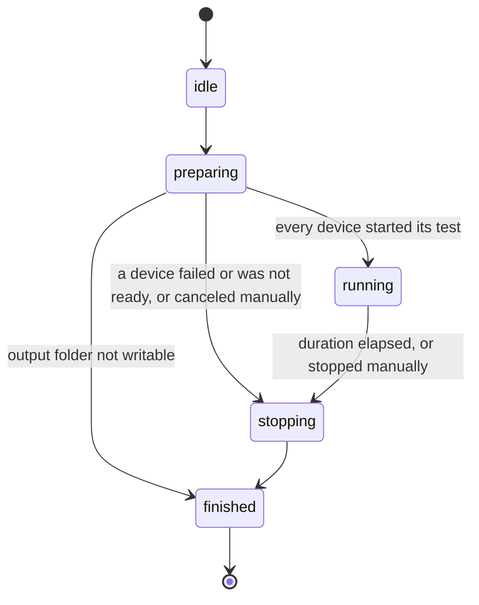
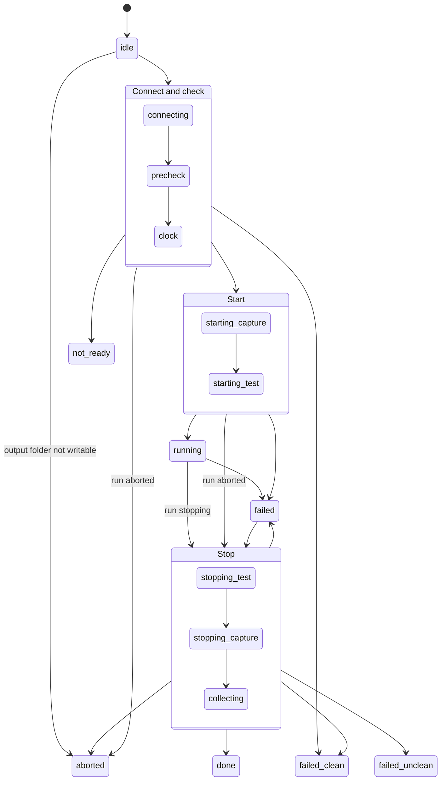

# C-V2X Interoperability Tester

Run a test on one or more Cellular-V2X devices (OBUs and RSUs) at the same time and collect packet
traces in pcap format while it runs.

For each run, cv2x-tester:

1. connects to every selected device over SSH, in parallel;
2. runs model-specific checks and measures each device's clock offset;
3. starts packet capture and then the test on all devices together;
4. waits for the chosen duration, or until the user presses **Stop**;
5. stops the test and the capture, then collects the traces;
6. merges the traces of each device that produced more than one (such as separate RX and TX
   captures) into a single `.pcap` file, and writes a `run.json` manifest.

Each of the first three steps waits for every device to finish before the next one begins, so the
tests start at approximately the same time. Each trace is timestamped by its device's own clock, so
the clocks should be roughly in sync. cv2x-tester checks the device clocks before every run, warns
if one is too far off, and records their offsets with the results.

## Install and run

Requires [uv](https://docs.astral.sh/uv/) and Python 3.15 or later.

```shell
uv sync
uv run cv2x-tester                                  # GUI, starts with an empty configuration
uv run cv2x-tester --config examples/mock.toml      # GUI with simulated devices
```

Headless use:

```shell
uv run cv2x-tester run --config cfg.toml --duration 1m30s --name bsm-range
uv run cv2x-tester run --config cfg.toml --device obu1 rsu1 --verbose
uv run cv2x-tester check --config cfg.toml                   # device pre-checks only
uv run cv2x-tester check --config cfg.toml --no-timestamps   # same, without timestamps
uv run cv2x-tester models                                    # supported models and options
```

**Exit codes:**

| Code | `run` | `check` |
| --- | --- | --- |
| 0 | success | every device passed |
| 1 | partial or failed execution | at least one device failed or was not ready |
| 2 | config or usage error | config or usage error |
| 3 | aborted before running | — |
| 130 | interrupted | interrupted |

**Ctrl+C:** pressing Ctrl+C once stops the run gracefully, or cancels it while it is still
preparing. The devices are stopped and their captures collected as usual. Pressing it a second time
quits immediately and skips the remaining stop steps, so a test or capture may be left running on a
device and some captures may be incomplete. The output then lists the devices that may still
be running.

## Configuration

A [TOML](https://toml.io) configuration file describes the devices to test and the settings shared
by all runs. [examples/config.toml](examples/config.toml) explains every setting and is a good
starting point.

The global settings must come first, before any device: where results are saved, the default test
duration, the timeouts, and the clock offset that triggers a warning. Each device is declared in its
own `[[devices]]` table, with a unique name, its model, its role (OBU or RSU), and how to reach it
over SSH. Settings specific to a model, such as the capture interface, go in the device's
`[devices.options]` table. Run `cv2x-tester models` to list the models and their options. A device
can be disabled, with `enabled = false` or its checkbox in the GUI, to leave it out of runs without
deleting it.

```toml
output_dir = "results"          # global settings
default_duration = 60

[[devices]]                     # one table per device
name = "my-rsu"
model = "generic-linux"
role = "rsu"
host = "192.168.0.20"
username = "user"
key_file = "~/.ssh/id_ed25519"

[devices.options]               # options of this device's model
interface = "wlan0"
```

The `run` and `check` commands need a configuration file, given with `--config`. The GUI can open
one at startup or from File → Open, or start with an empty configuration that you fill in and save.

A relative `output_dir` is relative to the current directory, or to the folder of the executable in
a packaged build. A relative `key_file` is relative to the folder of the configuration file.
In both settings, a leading `~` is expanded to the user's home folder, but environment variables
are not expanded.

If the file is not valid TOML, or a global setting is invalid, the file is not loaded at all.
A device with a problem, such as an unknown model or a name that is already used, is skipped with a
warning, and so are unknown keys.

Saving from the GUI rewrites the whole file with only the settings that differ from their defaults,
so comments and formatting are lost. If devices or keys were skipped when the file was loaded,
cv2x-tester asks before saving over it, since they would be lost as well.

Passwords and key passphrases are stored in the file as plain text, and cv2x-tester warns if such a
file can be read by other users. SSH host keys are not verified.

## Output

```text
<output_dir>/<YYYY-MM-DD_HH-MM-SS>[_<test_name>]/
  run.json        manifest: timings, outcome, per-device state, clock offsets, file hashes
  run.log         orchestrator log
  <device>.pcap   one capture per device
  <device>.log    every command, its output, and any non-zero exit status
  <device>_raw/   unmodified files from the device (with keep_raw_files, or if some could not be merged)
```

## Run and device states

A run goes through these states. The `run` command prints each state change.



A run that ends without reaching the `running` state is aborted, but the devices that started
capturing are still stopped. The outcome recorded in `run.json` is one of:

| Outcome | Meaning |
| --- | --- |
| `success` | Every device ended `done`, with a pcap file. |
| `partial` | At least one device has a pcap file, and at least one failed or has none. |
| `failed` | No device has a pcap file. |
| `aborted` | The run ended without reaching the `running` state. |
| `interrupted` | The run was force-quit, so the stop steps did not finish and the results are incomplete. |

Each device goes through these states:



The steps leading up to `running` are synchronized across devices. Each step begins only after every
device has completed the previous one, and a device that finishes a step early is `waiting` until
the others have finished it too. The exception is starting the test, after which a device is
immediately `running`. Similarly, captures are stopped only after every device has stopped its test,
so a device can also be `waiting` between `stopping_test` and `stopping_capture`. For clarity, the
diagram does not show the `waiting` state.

When a device fails, it enters the `failed` state. If its capture had already started, it then goes
through the stop steps like the other devices, so that its test and capture are stopped and the data
captured so far is collected. At the end of the run, each device is in one of the following
final states:

- `done`: the device completed the run without failing.
- `not_ready`: the pre-check found that the device works but is not in a state to run a test, for
  example because its C-V2X radio is not active. The run is aborted.
- `failed_clean` ("Failed" in the GUI): the device failed, but nothing is left running on it.
- `failed_unclean`: the device was not stopped cleanly, so its test or capture may still be running.
  A force quit leaves every device that was still capturing in this state.
- `aborted`: the run was aborted because of another device or a manual cancellation, and nothing is
  left running on the device.

## Built-in device models

| Model | Capture | Notes |
| --- | --- | --- |
| `cohda-mk6` | remote files | Starts and stops the device's `example1609` app, then downloads its capture files, merges them, and deletes them from the device. |
| `commsignia` | streamed | Streams a tcpdump capture over SSH. |
| `ettifos` | streamed | Streams a tcpdump capture over SSH. |
| `kapsch` | streamed | Streams a tcpdump capture over SSH. |
| `yunex` | streamed | Brings up the RX and TX interfaces, then streams a tcpdump capture of each over SSH and merges them. |
| `generic-linux` | streamed | Streams a tcpdump capture of the chosen interface over SSH and runs optional start/stop commands. |
| `mock` | streamed | Simulated device without SSH, for demos and tests. It can simulate several concurrent streams or a truncated capture. It can also inject a failure in most steps or report that it is not ready. |

## Adding a device model

To add support for a new device model:

1. Create a module for it in [`src/cv2x_tester/drivers/`](src/cv2x_tester/drivers/), for
   example `acme.py`.
2. In that module, define a driver class. Subclass `TcpdumpDriver` if the device can be captured by
   streaming tcpdump over SSH, or `Driver` otherwise.
3. Set the class's `model_id`, which is the value of `model` in the configuration file, and its
   `display_name`, which is shown in the GUI.
4. If the model has options, declare them in a dataclass that subclasses `DriverOptions`, and assign
   it to the class's `Options`. The device dialog shows them automatically.
5. Override the hooks that the device needs, as described below.

No other file needs to change. The module is loaded automatically, the driver registers itself
through its `model_id`, and the new model appears in the GUI and in `cv2x-tester models`.

**Streaming with tcpdump:** most devices can be captured this way. Subclass `TcpdumpDriver` and list
the interfaces to capture in `streams()`. Each stream runs its own tcpdump and is written to its own
file. After the capture stops, the files are merged into `<device>.pcap`. `TcpdumpDriver` starts and
stops tcpdump and reports live packet counts. For example:

```python
from dataclasses import dataclass

from ..options import option
from .tcpdump import SingleInterfaceOptions, TcpdumpDriver


@dataclass
class AcmeOptions(SingleInterfaceOptions):
    interface: str = option("wave0", help="Capture interface", required=True)
    tx_power: int = option(20, label="TX power (dBm)", min=0, max=33)


class AcmeRsu(TcpdumpDriver[AcmeOptions]):
    model_id = "acme-rsu"  # value of `model` in the config file
    display_name = "ACME RSU"
    vendor = "ACME"
    Options = AcmeOptions  # rendered automatically in the device dialog
    default_username = "admin"  # SSH username prefilled in the device dialog

    def streams(self):
        return [self.options.stream()]  # one stream, on the interface and filter options

    async def precheck(self):
        await self.run("acme-status --ok")
        await super().precheck()  # checks for tcpdump and, when required, passwordless sudo

    async def start_test(self):
        await self.run(f"acme-app start --role {self.device.role} --power {self.options.tx_power}")

    async def stop_test(self):
        await self.run("acme-app stop")
```

By default, `TcpdumpDriver` runs tcpdump as root, using `sudo -n` when the SSH user is not root.
If tcpdump can capture packets without root privileges on the device, override `needs_root()` to
return `False`.

**Hooks:** every hook of `Driver` is optional and has a default, so override only the ones the
device needs. `TcpdumpDriver` already implements `precheck`, `start_capture`, `stop_capture`,
`pcap_files_to_merge`, and `stats`. The hooks are listed below, and their docstrings in
[`drivers/base.py`](src/cv2x_tester/drivers/base.py) describe each one in detail:

- `precheck`
- `clock_sources` (`date` by default; override it if the device has a better way to read its clock)
- `start_capture`
- `start_test`
- `stop_test`
- `stop_capture`
- `collect`
- `pcap_files_to_merge`
- `cleanup`
- `stats` (live packet and byte counts, which the engine reads periodically during the capture)

**`REMOTE_FILES` drivers:** if the device writes the capture files itself, as Cohda devices do,
subclass `Driver`, set `capture_mode = CaptureMode.REMOTE_FILES`, and implement these hooks:

- `collect()`: download the files from the device with `self.download()`.
- `pcap_files_to_merge()`: return the files to merge into `<device>.pcap`.
- `cleanup()`: delete the remote files if `self.ctx.delete_remote_files` is set. It is skipped for a
  device that was not stopped cleanly, or whose files were not all collected.

**Running commands:** in the driver's methods, run commands on the device with `self.run()`, which
records each command, its output, and any non-zero exit status in the device log. Run commands that
need root privileges with `self.run_as_root()`, which prefixes them with `sudo -n` when the SSH user
is not root. Call `self.check_root_privileges()` at the start of `precheck()`, so that the pre-check
fails if sudo requires a password. To fail a step, raise `DriverError` with a message for the user.
If the device works but is not in a state to run a test, raise `DeviceNotReady` from `precheck()`
instead. On devices that provide the `cv2x_get_status` command, call `self.check_cv2x_status()`
from `precheck()`. It raises `DeviceNotReady` unless the C-V2X radio is active.

## Development

Format, lint, type-check, and test with:

```shell
uv run ruff format
uv run ruff check
uv run pyside6-qmlformat -i src/cv2x_tester/gui/qml/*.qml
uv run pyside6-project -q -Q build
uv run pyside6-qmllint src/cv2x_tester/gui/qml/*.qml
uv run mypy
uv run pytest
```

`pyside6-project` generates the QML types of the Python classes registered with `@QmlElement` into
`CV2XTester/`, so that `pyside6-qmllint` can check their use in QML. Run it again after changing the
properties, signals, or slots of these classes.
